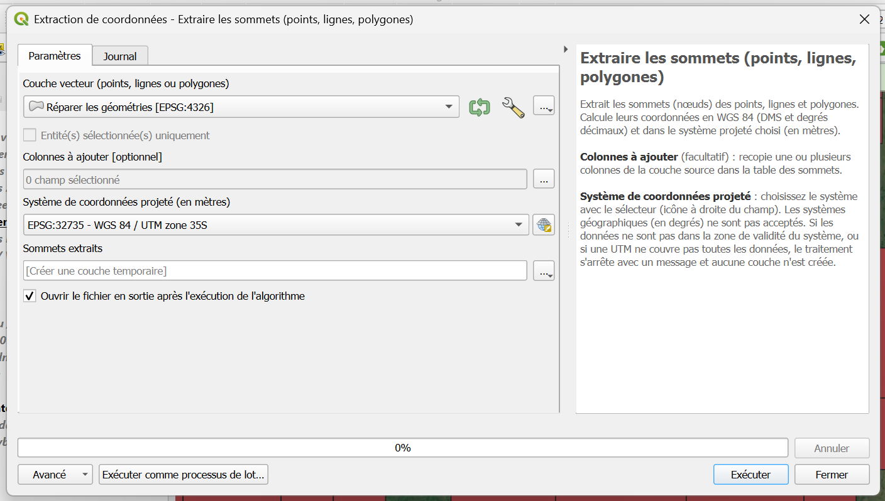
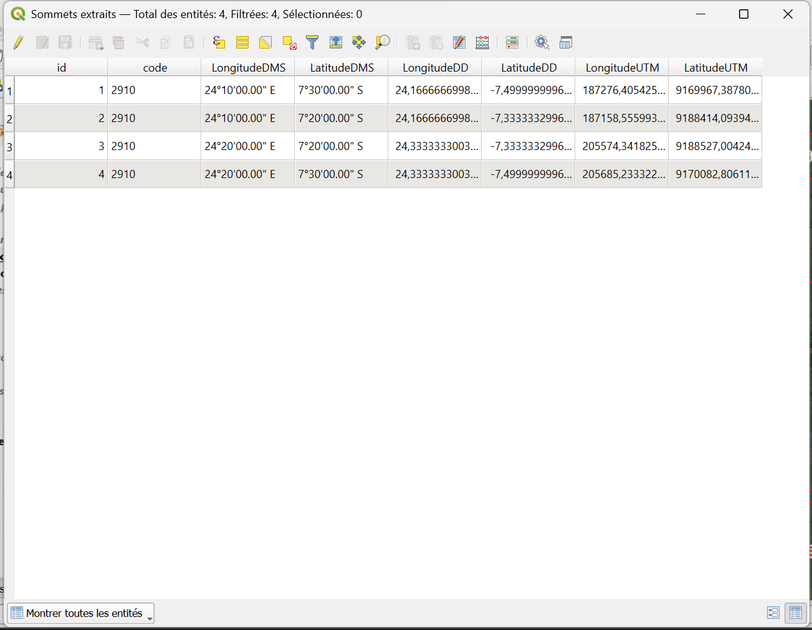

# Extract Coordinates

Extension QGIS qui extrait les sommets (nœuds) des couches vectorielles de type **(points), lignes ou polygones**, et calcule leurs coordonnées en plusieurs systèmes (Degrés Minutes Secondes (DMS), Degrés Décimals (DD) et Universal Transverse Mercator (UTM)).

## Fonctionnalités

- Extraction de tous les sommets d'une couche vectorielle de lignes ou de polygones mais fonctionne aussi sur le couche des points.
- Extraction des coordonnées en **degrés, minutes, secondes** (format `27°28'30.12" E`) de ses sommets (nœuds).
- Extraction des coordonnées en **degrés décimaux** (WGS 84, EPSG:4326) de ses sommets (nœuds).
- Extraction des coordonnées en **UTM** adapté à votre zone pour les sommets (nœuds) extrait.
- Ajout facultatif d'une ou plusieurs colonnes de la couche source.

## Installation

### Depuis le dépôt officiel de QGIS

1. Ouvrez QGIS, puis allez dans **Extensions > Gérer et installer les extensions**.
2. Cherchez `Extract Coordinates`.
3. Installez et **cochez** la case du plugin.

### Installation manuelle

1. Téléchargez le dépôt en cliquant sur **Code > Download ZIP**.
2. Décompressez le fichier, puis copiez le dossier `extract_coordinates` dans :
   `C:\Users\<votre nom>\AppData\Roaming\QGIS\QGIS3\profiles\default\python\plugins\`
3. Redémarrez QGIS et activez le plugin dans le gestionnaire d'extensions.

## Utilisation

1. Cliquez sur l'icône **Extract Coordinates** dans la barre d'outils, ou ouvrez la boîte à outils de traitement (**Ctrl+Alt+T**) et cherchez « Extraire les sommets ».
2. Dans **Couche vecteur**, choisissez une couche de points, de lignes ou de polygones.
3. Dans **Colonnes à ajouter (facultatif)**, cochez les colonnes à recopier. Vous pouvez laisser ce champ vide.
4. Dans **Système de coordonnées projeté**, choisissez le système voulu avec le sélecteur (icône à droite). Par défaut : WGS 84 / UTM zone 35S.
5. Dans **Sommets extraits**, indiquez le fichier de sortie (par exemple `sommets.gpkg`).
6. Cliquez sur **Exécuter**.

La couche créée s'ajoute automatiquement au projet.

## Colonnes produites

| Colonne | Contenu |
|---|---|
| `id` | Numéro du sommet, de 1 à n |
| `LongitudeDMS` | Longitude en degrés, minutes, secondes (E ou O) |
| `LatitudeDMS` | Latitude en degrés, minutes, secondes (N ou S) |
| `LongitudeDD` | Longitude en degrés décimaux (WGS 84) |
| `LatitudeDD` | Latitude en degrés décimaux (WGS 84) |
| `LongitudeUTM` | Coordonnée Est (ou X) dans le système projeté choisi (mètres) |
| `LatitudeUTM` | Coordonnée Nord (ou Y) dans le système projeté choisi (mètres) |

Les colonnes choisies à l'étape 3 sont ajoutées à la fin. Si leur nom est déjà utilisé, elles reçoivent le préfixe `attr_`.

## Remarques

- Pour un **polygone**, le sommet de fermeture (qui répète le premier sommet) n'est pas extrait ; les trous sont inclus.
- Les systèmes géographiques (en degrés) ne sont pas acceptés : les colonnes projetées sont toujours en mètres.
- Le traitement s'arrête, sans créer de couche, dans les cas suivants : données hors de la zone de validité du système choisi, couche sans système de coordonnées, couche vide, entités sans géométrie, données qui s'étendent sur plusieurs zones UTM, ou zone UTM qui ne correspond pas aux données.
- Pour une couche qui couvre plusieurs zones UTM, extrayez les données zone par zone.

## Signaler un problème

Pour signaler un bogue ou proposer une amélioration, ouvrez une demande sur la page **Issues** de ce dépôt.

## Tests

Les fonctions de calcul sont testées dans le dossier `test/test_calculs.py` :
conversion en DMS, code EPSG UTM et extraction des sommets des polygones (trous compris).

## Auteur

Maurice KANAMA : mauricekanama1@gmail.com

##
